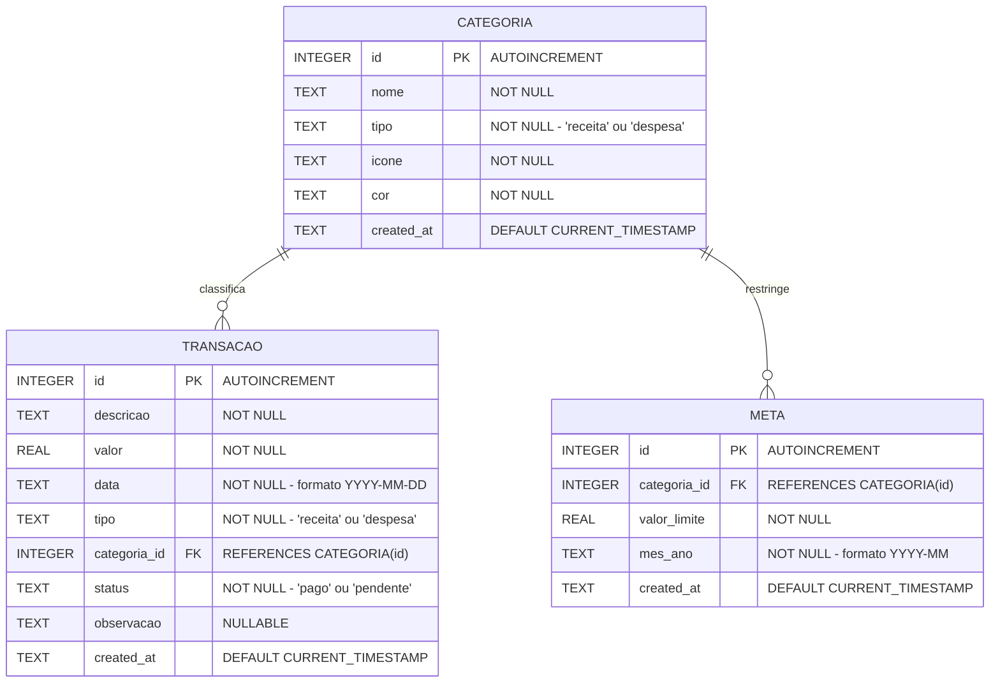

# FinPulse - Gestão Financeira Pessoal Inteligente

> Aplicativo móvel para controle financeiro pessoal, definição de metas de orçamento e análise de despesas. Projeto desenvolvido na disciplina de Desenvolvimento de Projetos para Dispositivos Móveis (TSI35A) - UTFPR.

---

## Sobre o app

O **FinPulse** é um aplicativo móvel voltado para o controle financeiro pessoal prático, intuitivo e com foco em privacidade (armazenamento 100% local no dispositivo). A aplicação foi concebida para auxiliar o usuário a registrar suas receitas e despesas diárias, acompanhar orçamentos por categoria e evitar endividamento, sem a necessidade de conexão permanente com a internet ou preenchimento de planilhas complexas.

Além do controle de caixa tradicional, o aplicativo oferece acompanhamento visual de metas de consumo por categoria (alertando quando o limite estipulado estiver próximo) e relatórios de distribuição de gastos por categoria.

### Funcionalidades Básicas (Prioritárias para Implementação)

> Legenda: itens marcados já estão implementados na interface. Até a Sprint 5 os dados vêm de mocks e ficam em memória (store Zustand); a persistência em SQLite entra no Checkpoint Final.

- [x] **Dashboard Financeiro (Home):**
  - [x] Card de saldo consolidado (total em conta).
  - [x] Resumo mensal com cards de receitas totais e despesas totais.
  - [x] Lista rápida das últimas 5 transações registradas.
  - [x] Ação rápida para inclusão de nova movimentação.
- [ ] **Gestão de Transações:**
  - [x] Cadastro de despesa e receita com descrição, valor monetário, data, categoria e status (pago ou pendente). _(em memória; persistência na Sprint 5)_
  - [x] Tela de detalhes da transação. _(adicionado no Checkpoint 2)_
  - [ ] Edição dos dados de transações existentes.
  - [ ] Exclusão de transações com confirmação de segurança.
  - [ ] Validação estrita de todos os campos de formulário via schemas Zod. _(hoje há validação básica dos campos obrigatórios)_
- [ ] **Categorização de Gastos:**
  - [x] Categorias padrão pré-carregadas (ex: Alimentação, Moradia, Transporte, Lazer, Saúde, Salário). _(via mock)_
  - [ ] Cadastro e personalização de novas categorias (nome, tipo, cor e ícone).
- [x] **Extrato e Histórico de Transações:**
  - [x] Listagem completa de movimentações ordenadas cronologicamente, agrupadas por dia.
  - [x] Filtro rápido por tipo (Todas, Apenas Receitas, Apenas Despesas).
  - [x] Barra de busca por termo textual. _(em memória; via SQL `LIKE` na Sprint 5)_
- [ ] **Metas e Orçamentos Mensais:**
  - [ ] Definição de teto de gastos por categoria no mês (ex: Lazer: até R$ 500,00). _(metas atuais vêm do mock)_
  - [x] Barra de progresso visual indicando a porcentagem já consumida do limite estipulado.
- [ ] **Persistência de Dados Local:**
  - [ ] Armazenamento relacional estruturado em banco SQLite local (`expo-sqlite`).
  - [ ] Implementação de camada de acesso a dados com Repository Pattern (`TransactionRepository`, `CategoryRepository`, `BudgetRepository`).

### Funcionalidades Adicionais (Trabalhos Futuros)

- [ ] **Gráficos e Relatórios Visuais:**
  - [ ] Gráfico demonstrativo com percentual de gastos por categoria. _(versão inicial com barras horizontais na tela de Relatórios)_
  - [ ] Histórico comparativo de despesas e receitas entre meses anteriores. _(versão inicial: comparativo com o mês anterior)_
- [ ] **Exportação e Backup de Relatórios:**
  - [ ] Exportação do extrato do mês selecionado nos formatos CSV ou PDF.
- [ ] **Segurança e Privacidade:**
  - [ ] Bloqueio de acesso ao aplicativo por biometria (Face ID / Fingerprint) ou senha numérica.
  - [ ] Modo "Ocultar Valores" no dashboard para uso em locais públicos.
- [ ] **Notificações Locais:**
  - [ ] Lembretes de vencimento de contas cadastradas como pendentes.
  - [ ] Alerta de limite orçamentário ultrapassando 80% da meta.

---

## Protótipos de tela

Os protótipos de interface e os fluxos de navegação da aplicação foram desenhados contemplando as diretrizes modernas de usabilidade mobile (tamanho de alvos de toque, legibilidade, acessibilidade e contraste visual).


- **Arquivo do Protótipo (HTML/Design):** [docs/prototipo_telas.html](docs/prototipo_telas.html) (Mapa de Telas e Fluxos Projetados)

1. **Dashboard / Visão Geral (`src/app/(tabs)/index.tsx`):**
   - Exibição dos cards de Saldo Atual, Receitas e Despesas do mês.
   - Gráfico de rosca ou indicador resumido das principais categorias de despesa.
   - Lista das movimentações mais recentes e botão de ação flutuante (FAB) para cadastrar movimentação.
2. **Extrato Completo (`src/app/(tabs)/extrato.tsx`):**
   - Barra de pesquisa para busca por descrição da movimentação.
   - Filtros por chips (_Todas_, _Receitas_, _Despesas_ e período).
   - Itens da lista com identificação visual por cor (verde para receitas, vermelho para despesas), ícone da categoria e valor.
3. **Metas de Orçamento (`src/app/(tabs)/metas.tsx`):**
   - Listagem das metas do mês com barras de progresso percentuais dinâmicas.
   - Indicadores visuais de alerta (verde para seguro, amarelo para atenção e vermelho para limite estourado).
4. **Relatórios e Resumo (`src/app/(tabs)/relatorios.tsx`):**
   - Visualização da distribuição percentual de despesas por categoria no mês.
   - Resumo de economia e balanço mensal.
5. **Modal / Tela de Nova Transação (`src/app/transacao/nova.tsx`):**
   - Formulário limpo com campos de valor monetário mascarado, descrição, seletor de categoria, seletor de data e switch de status (pago/pendente).
   - Exibição de mensagens de erro de validação em tempo real com Zod.
6. **Detalhes da Transação (`src/app/transacao/[id].tsx`):** _(tela adicionada no Checkpoint 2)_
   - Dados completos da movimentação selecionada no Dashboard ou no Extrato.

---

## Modelagem do banco

### Estratégia de Implementação

A persistência de dados do **FinPulse** será implementada **100% localmente no dispositivo** utilizando banco de dados relacional **SQLite** por meio do pacote oficial **`expo-sqlite`**.

Para manter o código desacoplado, testável e seguindo os padrões abordados na disciplina, a camada de banco de dados adotará o **Repository Pattern**:

- `TransactionRepository`: Responsável por inserção, edição, exclusão, listagem paginada, busca textual com `LIKE` e agregações de totais (`SUM`).
- `CategoryRepository`: Responsável por consultar categorias e popular dados padrão no primeiro boot da aplicação.
- `BudgetRepository`: Responsável por gerenciar metas e calcular os gastos acumulados por categoria no período.

### Diagrama Entidade-Relacionamento (DER)



### Dicionário de Dados

- **`CATEGORIA`**: Armazena as categorias disponíveis para classificação de receitas e despesas.
  - `id`: Chave primária inteira autoincremental.
  - `nome`: Nome descritivo da categoria (ex: Alimentação, Salário).
  - `tipo`: Define se é uma categoria aplicável a `'receita'` ou `'despesa'`.
  - `icone`: Nome do ícone da biblioteca de ícones (ex: FontAwesome / Ionicons).
  - `cor`: Código hexadecimal para identidade visual da categoria.
- **`TRANSACAO`**: Armazena o registro de cada movimentação financeira.
  - `id`: Chave primária inteira autoincremental.
  - `descricao`: Título resumido da movimentação (ex: "Compras no mercado").
  - `valor`: Montante em reais (numérico real positivo).
  - `data`: Data de competência da movimentação (ISO 8601 `YYYY-MM-DD`).
  - `tipo`: Classificação (`'receita'` ou `'despesa'`).
  - `categoria_id`: Chave estrangeira que referencia a tabela `CATEGORIA`.
  - `status`: Situação do pagamento (`'pago'` ou `'pendente'`).
  - `observacao`: Detalhamento textual complementar opcional.
- **`META`**: Armazena os tetos orçamentários definidos por categoria para um determinado mês.
  - `id`: Chave primária inteira autoincremental.
  - `categoria_id`: Categoria que possui limite estipulado.
  - `valor_limite`: Valor máximo planejado para gastos naquela categoria no mês.
  - `mes_ano`: Mês de referência no formato `'YYYY-MM'`.

---

## Planejamento de sprints

O desenvolvimento do projeto foi organizado em **6 Sprints** ao longo das 15 semanas da disciplina, cobrindo desde a concepção até a publicação e gravação da defesa final:

```
[Sprints 1 e 2: Semanas 1 a 4]   --> Checkpoint 1 (Documentação & Planejamento)
[Sprints 3 e 4: Semanas 5 a 9]   --> Checkpoint 2 (Roteamento, Estilização & Telas)
[Sprints 5 e 6: Semanas 10 a 15] --> Checkpoint Final (SQLite, Zod & Build APK)
```

Legenda: `[x]` tarefa concluída, `[ ]` tarefa pendente. Tarefas marcadas com _(nova)_ não estavam previstas no Checkpoint 1.

| Sprint | Duração | Foco Principal | Tarefas / Entregáveis | Status |
| :----- | :------ | :------------- | :-------------------- | :----- |
| **Sprint 1** | Semanas 1 e 2 | **Concepção e Requisitos** | [x] Definição do escopo do aplicativo e persona do usuário.<br>[x] Levantamento de requisitos funcionais e regras de negócio.<br>[x] Elaboração do documento de arquitetura e proposta de valor. | Concluído |
| **Sprint 2** | Semanas 3 e 4 | **Prototipação e Modelagem** | [x] Criação do protótipo navegável (Mobile UI).<br>[x] Modelagem do banco relacional SQLite e DER em Mermaid.<br>[x] Estruturação do `README.md` no repositório GitHub.<br>[x] **Entrega: Checkpoint 1**. | Concluído |
| **Sprint 3** | Semanas 5 e 6 | **Setup e Roteamento** | [x] Criação do projeto Expo com template TypeScript.<br>[x] Configuração de workflow no Git (Branches, PRs e commits semânticos).<br>[x] Estruturação do Expo Router com layouts aninhados (`Tabs` e `Stack`).<br>[x] Configuração de tema e biblioteca de ícones.<br>[x] _(nova)_ Configuração de ESLint e Prettier.<br>[x] _(nova)_ Ajuste do projeto para o Expo SDK 57, versão suportada pelo Expo Go das lojas. | Concluído |
| **Sprint 4** | Semanas 7 a 9 | **UI e Componentização** | [x] Configuração do NativeWind (Tailwind CSS) para estilização.<br>[x] Criação de componentes reutilizáveis em `src/components/` (12 componentes, entre eles `Card`, `SummaryCard` e `TransactionItem`).<br>[x] Implementação de dados mockados para testes visuais.<br>[x] _(nova)_ Store global com Zustand alimentado pelos mocks.<br>[x] _(nova)_ Telas Dashboard, Extrato, Metas, Relatórios, Nova Transação e Detalhes estilizadas e populadas.<br>[ ] Gravação do vídeo demonstrativo parcial.<br>[ ] **Entrega: Checkpoint 2**. | Em entrega |
| **Sprint 5** | Semanas 10 a 12 | **Persistência e Validação** | [ ] Criação do banco SQLite local (`expo-sqlite`) e migrations.<br>[ ] Implementação de `TransactionRepository`, `CategoryRepository` e `BudgetRepository`.<br>[ ] _(nova)_ Substituição dos mocks do store pelos repositories.<br>[ ] _(nova)_ Edição e exclusão de transações.<br>[ ] _(nova)_ Cadastro de categorias e de metas mensais.<br>[ ] Criação dos schemas de validação com **Zod** para os formulários.<br>[ ] Tratamento de erros, feedback visual e cálculo de balanços por categoria. | A Fazer |
| **Sprint 6** | Semanas 13 a 15 | **Build, Ajustes e Defesa** | [ ] Geração da build final do APK Android via **EAS Build**.<br>[ ] Criação de Release no GitHub com o `.apk` anexado.<br>[ ] Geração da imagem de destaques no Gerador de Cards da disciplina.<br>[ ] Gravação e publicação do vídeo final de defesa (máx. 7 min).<br>[ ] **Entrega: Checkpoint Final**. | A Fazer |

---

## Atualizações desde o último checkpoint

No Checkpoint 2 o app ganhou a estrutura de navegação, a estilização e as telas principais, todas populadas com dados fake e com o visual do protótipo.

### Telas implementadas

| Tela | Arquivo | O que já faz |
| :--- | :--- | :--- |
| Dashboard | `src/app/(tabs)/index.tsx` | Saldo, receitas e despesas do mês, atalhos para nova receita ou despesa, últimas 5 transações e botão flutuante |
| Extrato | `src/app/(tabs)/extrato.tsx` | Busca por descrição, filtro por tipo com contagem e lista agrupada por dia |
| Metas | `src/app/(tabs)/metas.tsx` | Orçamento total do mês e progresso por categoria com cores de alerta |
| Relatórios | `src/app/(tabs)/relatorios.tsx` | Balanço do mês, despesas por categoria e comparativo com o mês anterior |
| Nova Transação | `src/app/transacao/nova.tsx` | Formulário em modal com máscaras de valor e data, seletor de categoria e validação básica |
| Detalhes | `src/app/transacao/[id].tsx` | Dados completos da transação selecionada |

### Recursos dos módulos aplicados

- **Workflow no Git (módulo 05):** cada funcionalidade foi feita em uma branch própria (`feat/...`, `chore/...`, `fix/...`, `docs/...`) e entrou na `main` por Pull Request com _Squash and Merge_, mantendo um commit por funcionalidade. A issue "Configurações iniciais" (#3) foi fechada pela PR de mesmo nome (#4). PRs do checkpoint: #2, #4, #5, #6, #7, #8, #9, #10, #11, #12 e esta atualização do README.
- **Expo Router (módulo 06):** usei layouts aninhados, com um `Stack` no layout raiz (`src/app/_layout.tsx`) e `Tabs` no grupo `(tabs)` (`src/app/(tabs)/_layout.tsx`) para Início, Extrato, Metas e Relatórios. A Nova Transação abre como modal (`presentation: 'modal'`), o detalhe usa rota dinâmica (`transacao/[id].tsx` com `useLocalSearchParams`) e há uma tela `+not-found`. Os títulos do header e das abas estão configurados nos `_layout.tsx`, e a navegação usa `Link` e `router.push` com rotas tipadas (typed routes).
- **NativeWind (módulo 07):** usei NativeWind para estilizar todas as telas e componentes com `className`. As cores do protótipo viraram classes semânticas no `tailwind.config.js` (`brand`, `income`, `expense`, `warning`), e o `prettier-plugin-tailwindcss` ordena as classes automaticamente.
- **Zustand (módulo 02):** criei o store `useFinanceStore` (`src/store/useFinanceStore.ts`), que guarda transações, categorias, metas e o filtro e a busca do Extrato (mantidos ao trocar de aba). Ele expõe hooks derivados (`useBalance`, `useMonthSummary`, `useFilteredTransactions`, `useBudgetsProgress`, `useExpensesByCategory`), e a Nova Transação usa a ação `addTransaction` para atualizar todas as telas ao mesmo tempo.
- **Mocks (módulos 03 e 06):** os dados fake ficam em `src/mocks/` (10 categorias, 35 transações e 5 metas), com datas geradas a partir do dia atual para que as telas sempre tenham dados. As telas leem os dados apenas pelo store, então no Checkpoint Final os mocks serão trocados pelos repositories do SQLite sem alterar as telas.
- **React Native Elements (módulo 08):** não foi usado. A RNEUI tem seu próprio sistema de estilização por temas e não foi feita para trabalhar junto com Tailwind, então optei por manter só o NativeWind. Os campos do formulário usam os componentes nativos do React Native (`TextInput`, `Switch`, `Pressable`) dentro de componentes próprios (`FormField` e `CategoryPicker`).

### Boas práticas para componentes reutilizáveis

Os 12 componentes próprios ficam em `src/components/`, e os cálculos ficam em funções puras em `src/utils/`, fora dos componentes.

| Conceito (módulo 03) | Onde foi aplicado |
| :--- | :--- |
| Isolamento de componentes que se repetem | `TransactionItem` (usado no Dashboard e no Extrato), `SummaryCard` (saldo, receitas e despesas) e `ProgressBar` (Metas e Relatórios) |
| Nomenclatura minimalista e descritiva | `Card`, `Fab`, `SearchBar`, `FilterChips`, `FormField`, `EmptyState` |
| Parametrização via `interface` | `SummaryCard` (`variant`, `label`, `value`), `BudgetProgress` (`spent`, `limit`), `CategoryIcon` (`icon`, `color`, `size`) |
| Uso de mocks para popular a interface | `src/mocks/` consumidos pelo store `useFinanceStore` |
| Componentes que recebem `children` | `Card.Body`, `Card.Footer`, `FormField` (envolve o campo) e `EmptyState` |
| Componente composto (agrupamento de exports) | `Card`, usado como `Card.Header`, `Card.Body` e `Card.Footer` |
| Componentes que disparam eventos para o pai | `TransactionItem` (`onPress(id)`), `FilterChips` (`onChange`), `SearchBar` (`onChangeText`), `CategoryPicker` (`onSelect`) e `Fab` (`onPress`) |
| Componente genérico | `FilterChips<T>`, reaproveitado no filtro do Extrato e no seletor Despesa/Receita do formulário |

### Mudanças em relação ao planejamento

- **Expo SDK 57:** o projeto foi criado no SDK 58, mas o Expo Go publicado nas lojas ainda roda o SDK 57, então o projeto foi ajustado para essa versão (PR #7).
- **Pasta `src/`:** seguindo o template atual do Expo, o código fica em `src/` e as rotas em `src/app/`.
- **Sem React Native Elements:** a estilização ficou só com NativeWind (ver acima).
- **Tela de detalhes:** não estava no protótipo, mas foi adicionada para consultar uma transação a partir das listas.
- **Validação:** por enquanto o formulário tem validação básica dos campos obrigatórios; os schemas Zod seguem previstos para a Sprint 5.
- **Relatórios:** a distribuição por categoria é mostrada com barras horizontais; o gráfico de rosca continua nos trabalhos futuros.

### Próximas etapas

Sprint 5: banco SQLite com Repository Pattern no lugar dos mocks, edição e exclusão de transações, cadastro de categorias e metas, e validação com Zod. Depois, a Sprint 6 com a build do APK via EAS e a entrega final.

---

## Tecnologias e Ferramentas Previstas

- **Ambiente de Desenvolvimento:** Node.js, npm, Expo CLI.
- **Framework Mobile:** [React Native](https://reactnative.dev/) com [Expo](https://expo.dev/) (SDK 57, versão suportada pelo Expo Go das lojas) e TypeScript.
- **Roteamento:** [Expo Router](https://docs.expo.dev/router/introduction/) (File-based routing).
- **Estilização:** [NativeWind](https://www.nativewind.dev/) (Tailwind CSS para React Native).
- **Gerenciamento de Estado:** [Zustand](https://docs.pmnd.rs/zustand) e `@react-native-async-storage/async-storage`.
- **Banco de Dados Local:** [Expo SQLite](https://docs.expo.dev/versions/latest/sdk/sqlite/) com Repository Pattern.
- **Validação de Schemas:** [Zod](https://zod.dev/).
- **Compilação e Publicação:** [EAS Build](https://docs.expo.dev/build/introduction/).
- **Qualidade de Código:** ESLint (`eslint-config-expo`) e Prettier.

---

## Como executar o projeto

### Pré-requisitos

- [Node.js](https://nodejs.org/) 20 ou superior (com npm)
- Aplicativo [Expo Go](https://expo.dev/go) no celular, ou um emulador Android / simulador iOS

### Passo a passo

```bash
# 1. Clonar o repositório
git clone https://github.com/Gabrielmororo180/Dev-Projetos-Dispositivos--moveis.git
cd Dev-Projetos-Dispositivos--moveis

# 2. Instalar as dependências
npm install

# 3. Iniciar o servidor de desenvolvimento
npx expo start
```

Com o servidor rodando, leia o QR Code com o Expo Go (Android) ou com a câmera (iOS), ou pressione `a` para abrir no emulador Android e `w` para abrir no navegador.

### Scripts úteis

| Comando | Descrição |
| :--- | :--- |
| `npm start` | Inicia o servidor do Expo |
| `npm run android` | Abre o app no emulador Android |
| `npm run web` | Abre o app no navegador |
| `npm run lint` | Verifica o código com ESLint |
| `npm run typecheck` | Verifica os tipos com TypeScript |
| `npm run format` | Formata o código com Prettier |
