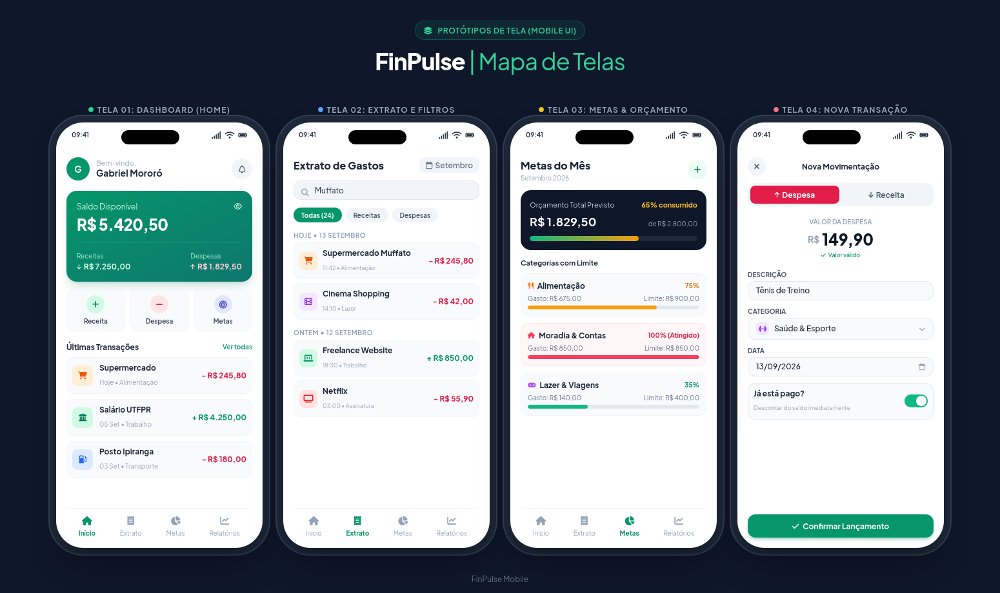
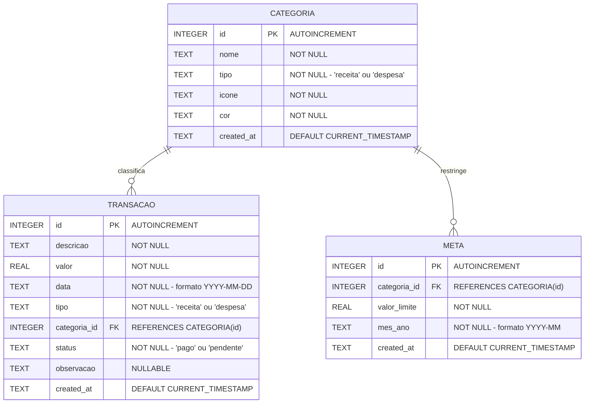

# FinPulse - Gestão Financeira Pessoal Inteligente

> Aplicativo móvel para controle financeiro pessoal, definição de metas de orçamento e análise de despesas. Projeto desenvolvido na disciplina de Desenvolvimento de Projetos para Dispositivos Móveis (TSI35A) - UTFPR.

---

## Sobre o app

O **FinPulse** é um aplicativo móvel voltado para o controle financeiro pessoal prático, intuitivo e com foco em privacidade (armazenamento 100% local no dispositivo). A aplicação foi concebida para auxiliar o usuário a registrar suas receitas e despesas diárias, acompanhar orçamentos por categoria e evitar endividamento, sem a necessidade de conexão permanente com a internet ou preenchimento de planilhas complexas.

Além do controle de caixa tradicional, o aplicativo oferece acompanhamento visual de metas de consumo por categoria (alertando quando o limite estipulado estiver próximo) e relatórios de distribuição de gastos por categoria.

### Funcionalidades Básicas (Prioritárias para Implementação)

- [ ] **Dashboard Financeiro (Home):**
  - [ ] Card de saldo consolidado (total em conta).
  - [ ] Resumo mensal com cards de receitas totais e despesas totais.
  - [ ] Lista rápida das últimas 5 transações registradas.
  - [ ] Ação rápida para inclusão de nova movimentação.
- [ ] **Gestão de Transações:**
  - [ ] Cadastro de despesa e receita com descrição, valor monetário, data, categoria e status (pago ou pendente).
  - [ ] Edição dos dados de transações existentes.
  - [ ] Exclusão de transações com confirmação de segurança.
  - [ ] Validação estrita de todos os campos de formulário via schemas Zod.
- [ ] **Categorização de Gastos:**
  - [ ] Categorias padrão pré-carregadas (ex: Alimentação, Moradia, Transporte, Lazer, Saúde, Salário).
  - [ ] Cadastro e personalização de novas categorias (nome, tipo, cor e ícone).
- [ ] **Extrato e Histórico de Transações:**
  - [ ] Listagem completa de movimentações ordenadas cronologicamente.
  - [ ] Filtro rápido por tipo (Todas, Apenas Receitas, Apenas Despesas).
  - [ ] Barra de busca por termo textual (filtro via SQL `LIKE`).
- [ ] **Metas e Orçamentos Mensais:**
  - [ ] Definição de teto de gastos por categoria no mês (ex: Lazer: até R$ 500,00).
  - [ ] Barra de progresso visual indicando a porcentagem já consumida do limite estipulado.
- [ ] **Persistência de Dados Local:**
  - [ ] Armazenamento relacional estruturado em banco SQLite local (`expo-sqlite`).
  - [ ] Implementação de camada de acesso a dados com Repository Pattern (`TransactionRepository`, `CategoryRepository`, `BudgetRepository`).

### Funcionalidades Adicionais (Trabalhos Futuros)

- [ ] **Gráficos e Relatórios Visuais:**
  - [ ] Gráfico demonstrativo com percentual de gastos por categoria.
  - [ ] Histórico comparativo de despesas e receitas entre meses anteriores.
- [ ] **Exportação e Backup de Relatórios:**
  - [ ] Exportação do extrato do mês selecionado nos formatos CSV ou PDF.
- [ ] **Segurança e Privacidade:**
  - [ ] Bloqueio de acesso ao aplicativo por biometria (Face ID / Fingerprint) ou senha numérica.
  - [ ] Modo "Ocultar Valores" no dashboard para uso em locais públicos.
- [ ] **Notificações Locais:**
  - [ ] Lembretes de vencimento de contas cadastradas como pendentes.
  - [ ] Alerta de limite orçamentário ultrapassando 80% da meta.

---

## Protótipos de tela

Os protótipos de interface e os fluxos de navegação da aplicação foram desenhados contemplando as diretrizes modernas de usabilidade mobile (tamanho de alvos de toque, legibilidade, acessibilidade e contraste visual).



- **Arquivo do Protótipo (HTML/Design):** [docs/prototipo_telas.html](docs/prototipo_telas.html) (Mapa de Telas e Fluxos Projetados)

1. **Dashboard / Visão Geral (`app/(tabs)/index.tsx`):**
   - Exibição dos cards de Saldo Atual, Receitas e Despesas do mês.
   - Gráfico de rosca ou indicador resumido das principais categorias de despesa.
   - Lista das movimentações mais recentes e botão de ação flutuante (FAB) para cadastrar movimentação.
2. **Extrato Completo (`app/(tabs)/extrato.tsx`):**
   - Barra de pesquisa para busca por descrição da movimentação.
   - Filtros por chips (_Todas_, _Receitas_, _Despesas_ e período).
   - Itens da lista com identificação visual por cor (verde para receitas, vermelho para despesas), ícone da categoria e valor.
3. **Metas de Orçamento (`app/(tabs)/metas.tsx`):**
   - Listagem das metas do mês com barras de progresso percentuais dinâmicas.
   - Indicadores visuais de alerta (verde para seguro, amarelo para atenção e vermelho para limite estourado).
4. **Relatórios e Resumo (`app/(tabs)/relatorios.tsx`):**
   - Visualização da distribuição percentual de despesas por categoria no mês.
   - Resumo de economia e balanço mensal.
5. **Modal / Tela de Nova Transação (`app/transacao/nova.tsx`):**
   - Formulário limpo com campos de valor monetário mascarado, descrição, seletor de categoria, seletor de data e switch de status (pago/pendente).
   - Exibição de mensagens de erro de validação em tempo real com Zod.

---

## Modelagem do banco

### Estratégia de Implementação

A persistência de dados do **FinPulse** será implementada **100% localmente no dispositivo** utilizando banco de dados relacional **SQLite** por meio do pacote oficial **`expo-sqlite`**.

Para manter o código desacoplado, testável e seguindo os padrões abordados na disciplina, a camada de banco de dados adotará o **Repository Pattern**:

- `TransactionRepository`: Responsável por inserção, edição, exclusão, listagem paginada, busca textual com `LIKE` e agregações de totais (`SUM`).
- `CategoryRepository`: Responsável por consultar categorias e popular dados padrão no primeiro boot da aplicação.
- `BudgetRepository`: Responsável por gerenciar metas e calcular os gastos acumulados por categoria no período.

### Diagrama Entidade-Relacionamento (DER)



### Dicionário de Dados

- **`CATEGORIA`**: Armazena as categorias disponíveis para classificação de receitas e despesas.
  - `id`: Chave primária inteira autoincremental.
  - `nome`: Nome descritivo da categoria (ex: Alimentação, Salário).
  - `tipo`: Define se é uma categoria aplicável a `'receita'` ou `'despesa'`.
  - `icone`: Nome do ícone da biblioteca de ícones (ex: FontAwesome / Ionicons).
  - `cor`: Código hexadecimal para identidade visual da categoria.
- **`TRANSACAO`**: Armazena o registro de cada movimentação financeira.
  - `id`: Chave primária inteira autoincremental.
  - `descricao`: Título resumido da movimentação (ex: "Compras no mercado").
  - `valor`: Montante em reais (numérico real positivo).
  - `data`: Data de competência da movimentação (ISO 8601 `YYYY-MM-DD`).
  - `tipo`: Classificação (`'receita'` ou `'despesa'`).
  - `categoria_id`: Chave estrangeira que referencia a tabela `CATEGORIA`.
  - `status`: Situação do pagamento (`'pago'` ou `'pendente'`).
  - `observacao`: Detalhamento textual complementar opcional.
- **`META`**: Armazena os tetos orçamentários definidos por categoria para um determinado mês.
  - `id`: Chave primária inteira autoincremental.
  - `categoria_id`: Categoria que possui limite estipulado.
  - `valor_limite`: Valor máximo planejado para gastos naquela categoria no mês.
  - `mes_ano`: Mês de referência no formato `'YYYY-MM'`.

---

## Planejamento de sprints

O desenvolvimento do projeto foi organizado em **6 Sprints** ao longo das 15 semanas da disciplina, cobrindo desde a concepção até a publicação e gravação da defesa final:

```
[Sprints 1 e 2: Semanas 1 a 4]   --> Checkpoint 1 (Documentação & Planejamento)
[Sprints 3 e 4: Semanas 5 a 9]   --> Checkpoint 2 (Roteamento, Estilização & Telas)
[Sprints 5 e 6: Semanas 10 a 15] --> Checkpoint Final (SQLite, Zod & Build APK)
```

| Sprint       | Duração         | Foco Principal               | Tarefas / Entregáveis Previstos                                                                                                                                                                                                                                                                   | Status    |
| :----------- | :-------------- | :--------------------------- | :------------------------------------------------------------------------------------------------------------------------------------------------------------------------------------------------------------------------------------------------------------------------------------------------ | :-------- |
| **Sprint 1** | Semanas 1 e 2   | **Concepção e Requisitos**   | • Definição do escopo do aplicativo e persona do usuário.• Levantamento de requisitos funcionais e regras de negócio.• Elaboração do documento de arquitetura e proposta de valor.                                                                                                                | Concluído |
| **Sprint 2** | Semanas 3 e 4   | **Prototipação e Modelagem** | • Criação do protótipo navegável (Mobile UI).• Modelagem do banco relacional SQLite e DER em Mermaid.• Estruturação do `README.md` no repositório GitHub.• **Entrega: Checkpoint 1**.                                                                                                             | Concluído |
| **Sprint 3** | Semanas 5 e 6   | **Setup e Roteamento**       | • Criação do projeto Expo com template TypeScript.• Configuração de workflow no Git (Branches, PRs e commits semânticos).• Estruturação do Expo Router com layouts aninhados (`Tabs` e `Stack`).• Configuração de tema e biblioteca de ícones.                                                    | A Fazer   |
| **Sprint 4** | Semanas 7 a 9   | **UI e Componentização**     | • Configuração do NativeWind (Tailwind CSS) para estilização.• Criação de componentes reutilizáveis em `components/` (`Card`, `SummaryCard`, `TransactionItem`).• Implementação de dados mockados para testes visuais.• Gravação do vídeo demonstrativo parcial.• **Entrega: Checkpoint 2**.      | A Fazer   |
| **Sprint 5** | Semanas 10 a 12 | **Persistência e Validação** | • Criação do banco SQLite local (`expo-sqlite`) e migrations.• Implementação de `TransactionRepository`, `CategoryRepository` e `BudgetRepository`.• Criação dos schemas de validação com **Zod** para os formulários.• Tratamento de erros, feedback visual e cálculo de balanços por categoria. | A Fazer   |
| **Sprint 6** | Semanas 13 a 15 | **Build, Ajustes e Defesa**  | • Geração da build final do APK Android via**EAS Build**.• Criação de Release no GitHub com o `.apk` anexado.• Geração da imagem de destaques no Gerador de Cards da disciplina.• Gravação e publicação do vídeo final de defesa (máx. 7 min).• **Entrega: Checkpoint Final**.                    | A Fazer   |

---

## Tecnologias e Ferramentas Previstas

- **Ambiente de Desenvolvimento:** Node.js, Yarn / npm, Expo CLI.
- **Framework Mobile:** [React Native](https://reactnative.dev/) com [Expo](https://expo.dev/) e TypeScript.
- **Roteamento:** [Expo Router](https://docs.expo.dev/router/introduction/) (File-based routing).
- **Estilização:** [NativeWind](https://www.nativewind.dev/) (Tailwind CSS para React Native) e [React Native Elements](https://reactnativeelements.com/).
- **Gerenciamento de Estado:** [Zustand](https://docs.pmnd.rs/zustand) e `@react-native-async-storage/async-storage`.
- **Banco de Dados Local:** [Expo SQLite](https://docs.expo.dev/versions/latest/sdk/sqlite/) com Repository Pattern.
- **Validação de Schemas:** [Zod](https://zod.dev/).
- **Compilação e Publicação:** [EAS Build](https://docs.expo.dev/build/introduction/).
